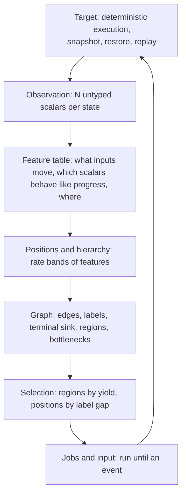
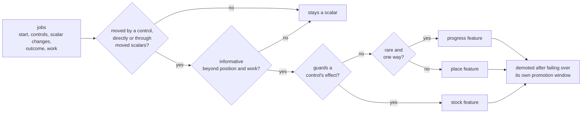
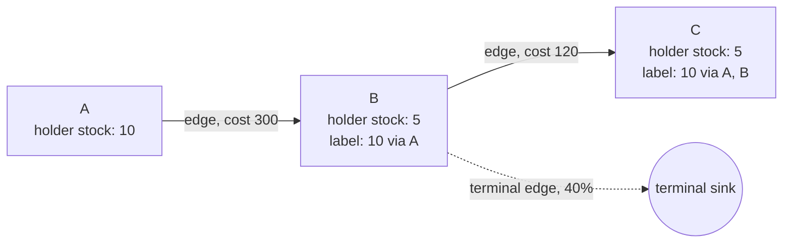
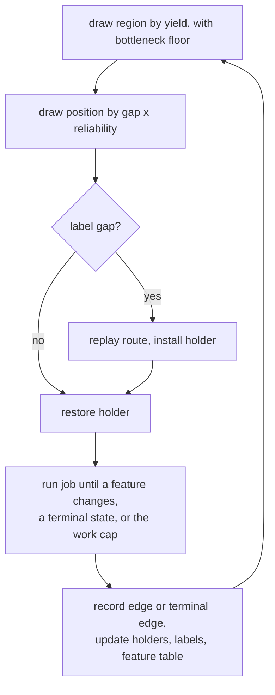

# Dissonance v3

Dissonance v3 is a state-exploration searcher. It drives a deterministic
target from power-on by restoring saved states, running short drawn
inputs, and keeping the endpoints that reach new places or bring better
stock to known places. It learns what counts as a place and what counts as
stock from the target's own observed state. It plans over the graph of
states it has visited. No per-target knowledge enters the searcher.

A target is anything the Harmony substrate can execute deterministically:
a game under an emulator, or a service under the VMM with fault injection.
The searcher sees every target the same way.

## Layers

Every layer takes only the layer below it. The observation layer is the
one place a target adapter exists, and it supplies format, never meaning.

## Observation

A state is observed as a vector of N scalars, each with an index and a
value and no name. The vector has two parts:

- the target's current state, such as memory bytes, registers, counters;
- the lineage's cumulative events, such as code paths hit, assertions
  fired, log templates seen, since power-on along this lineage.

The second part is state for the purpose of exploration: what a lineage
has caused is part of where it is. Cumulative scalars are directed by
construction.

An adapter emits scalars, from a handful to a few thousand, each a memory
field read at its natural width: a 16-bit position is one scalar, a 4-byte
counter is one scalar. A game adapter can emit every RAM byte; a service
adapter emits its counters and coverage. The adapter says which bytes form
each scalar and nothing else: no name, no order, no direction, no meaning.
Everything the searcher knows about a scalar it learns from the record,
including whether it matters: input effects, below, decide which scalars
the searcher keeps.

## Feature table

A feature is a scalar, or a group of scalars that always change on the
same step, that the searcher has promoted. Features are ordered by how fast
they change, and that order builds the hierarchy. There are three kinds. A
**progress feature** changes rarely and in one direction, like the level or
items held. A **place feature** changes often, in either direction, like
horizontal position. A **stock feature** guards what an input can do, like
ammunition: firing lowers a door's energy only while ammunition is above
zero. The searcher keeps one table with a row per scalar or group.

### Input effects

A target takes input through controls: a controller button for a game, a
fault or a workload action for a service. The searcher measures what each
control does to each scalar. Jobs that start from the same state and differ
in input are controlled experiments, since the target is deterministic. For
a control and a scalar, the searcher compares the scalar's change in a
window of work after the control turns on with its change over the same
window in jobs from the same start where the control stays off. The window
covers delayed effects, such as a shot that lands some steps after the
press. The threshold comes from a permutation test that shuffles control
timings among jobs from the same start. Every pair is scored against the
best pair of every shuffle, so testing more scalars admits no more false
effects.

Each scalar gets one of three results:

- **direct**: some control has an effect on it, as left and right do on
  horizontal position;
- **indirect**: no control moves it directly, but preceding changes of
  directly moved scalars predict its changes, as horizontal position
  predicts the level;
- **none**: neither controls nor moved scalars predict its changes, as with
  a timer or a frame counter. Such a scalar is something done to the
  target, never by the search, and is not promoted.

An effect that holds from some starts and fails from others has a guard.
Among starts that share a position, the searcher finds the scalar that best
separates the starts where the effect held from those where it failed, the
split a decision tree would choose, and records that scalar and the side of
the split that enables the effect. Comparing starts at one position keeps
the position itself from being chosen as the guard. Searching for guards only
behind inconsistent effects keeps the cost near controls times scalars.
Chains form through guards: firing moves ammunition and door energy, and
ammunition guards the effect on door energy.

### Promotion

One test decides whether a moved scalar is a feature: whether it is
**informative**. Take the jobs that started from one position, with the
candidate scalar left out of the position, and ask whether the
candidate's value at the start predicts the job's outcome: the position it
reached and whether it ended terminal. In standard terms this is the
conditional mutual information between outcome and scalar given position
and work. The threshold comes from a permutation test: the candidate's
values are shuffled among the starts that share a position and fall in the
same stretch of the record, and the scalar is informative when its real
value exceeds what the shuffles produce. Including work in the
conditioning rejects a clock. Shuffling only within a stretch of the record
rejects a scalar that tracks only how long the search has run. The outcome
has one part per position scalar plus terminal; each part is scored
against its own shuffles, and the best part must beat the best part of
every shuffle.

Guarding, change rate and direction then set the kind. An informative scalar
that guards an effect is a stock feature, with the enabling side as its
direction. Of the rest, one that changes rarely and in one direction along
lineages is a progress feature, and every other one is a place feature.
Rates are measured over jobs that did not end terminal: a scalar's change
rate is the share of those jobs that change it. The informative scalars
are sorted by change rate, and the rare ones are those below the largest
gap in the logarithm of change rate. A scalar changes in one direction
when no job in the evaluation window moved it the other way. Both splits
come from the record, never from fixed constants. A scalar that is not
informative is not promoted, however it moves.

| Scalar | What moves it | Outcome depends on it at fixed position | Rate, direction | Result |
|---|---|---|---|---|
| level | indirect | yes | rare, one way | progress |
| x, y | direct | yes | frequent, both ways | place |
| room in a game with revisited areas | indirect | yes | rare, both ways | place |
| scroll in a runner | direct | yes | frequent, one way | place |
| ammunition | direct; guards firing on door energy | yes | frequent, both ways | stock |
| score | indirect | no | rare, one way | none |
| frame or animation counter | none | | frequent | none |
| timer | none | | steady, one way | none |

Informativeness runs per region, so one scalar can form positions in one
region and be noise in another. Input effects, rate and direction are
global.

Every job, kept or not, adds to the table. Promotion and demotion are
evaluated at checkpoints, since the permutation tests need many starts and
every change rebuilds positions. A feature is demoted in a region only
after it has failed across a window in which it changed at least as many
times as in the evidence that promoted it. A slow feature therefore needs
long contrary evidence to lose its place, and a fast one is re-tested
quickly.

## Positions and hierarchy

Progress features are the slow end of the change-rate order. They are
global by construction and define regions. A region's place features,
bucketed to a width learned from their step size, define positions there.

- A **region** is the set of states sharing the values of the progress
  features. A lineage never returns to a region it has left, since
  progress features never move back.
- A **position** is the tuple of the region's bucketed place feature
  values at a state, paired with the tuple the job left to reach it. A state reached by a transition no job
  has made is kept even when its tuple has been seen, so state the chosen
  scalars miss still shows up as new transitions.
- A **bottleneck** is a transition on which a progress feature changes.
- **Depth** is the number of bottlenecks from power-on.

When a region's promoted set changes, that region's positions are rebuilt
from its resident states. Other regions are untouched. The hierarchy is a
measured property of the data and moves as the table moves.

Before any feature is promoted there is one region, and every chosen
scalar is a place feature bucketed by the square-root rule for histogram
bins: width is the range the scalar's observed values cover divided by the
square root of its count of distinct values, rounded up to a power of two.
A gap between consecutive values counts toward the covered range at most
one width, so a distant cluster of values does not widen every bucket; the
width is the fixed point of that equation. The width depends only on the
values seen, never on job length. Rounding to a power of two means
positions are rebuilt only when a width changes, a number of times
logarithmic in the range. A position is then the
tuple of every scalar's bucket, so any state whose vector lands in a new
tuple is kept. Promotion and demotion rebuild positions from this starting
point by the rule above; bucket widths follow the record and scalars leave
the position when the table rejects them. There is no separate bootstrap, no handoff and no model
learned ahead of the run.

## Graph

The search keeps the graph it walks.

- A **node** is a position with its holder, the state with the best stock
  observed there. Stock is the vector of stock features; one state has
  better stock than another when it is at least as far to the enabling
  side in every stock feature and further in one. Stock features are not part of the position.
- An **edge** records that a job went from one position to another with a
  given input suffix and cost. Each edge keeps a landing rate,
  (landed + 1) / (attempted + 2).
- A **finding** is a state that meets the search's goal: the ending of a
  game, or a failed check or a crash in a service. A finding is recorded
  as a result and is never a terminal edge.
- A **terminal edge** goes from a position to the terminal sink when a job
  from it ended at a state no job can continue from that is not a finding.
  It lowers the reliability of every route through that position.
- A **label** on a position is the best stock any route of edges can bring
  there, with the route, its cost and its reliability. Labels are kept
  current by bounded relaxation over edges whenever a holder changes.

A label says more can be brought to a position than has arrived there.
Realizing a label replays its route from the holder at its start.

## Selection

Work is allocated at two levels.

Across regions, a region's share is its recent yield: novel positions and
label improvements per unit of work, discounted by terminal edges. Every
region is credited one novel position in advance against ten median job
lengths of work, so no share reaches zero. A region is crossed once any
job leaves it, including a job that started in an earlier region. Since a
lineage never returns to a region it left, crossing means an exit has been
found; areas a game lets the player leave and re-enter are place
features. A region's yield when it is first crossed is its **entry
yield**. An uncrossed region is credited at least the median entry yield
of the crossed regions, the yield regions showed until their exit was
found, so a bottleneck keeps the share a region has while it is the
frontier. Leaving a crossed region is worthwhile only when a label says a better-stocked
state can be brought in, or when another region is still yielding. Stock
found anywhere becomes a label at the bottleneck through relaxation, so
work elsewhere is credited there without a rule.

Within a region, a position's weight is its label gap, the distance between
its label and its holder's stock, times the route's reliability. Positions
without a gap share the remainder in proportion to the novel positions
found from them per unit of work, with the region's median job length as
prior work. Every position's weight is multiplied by its holder's
survival, (children that did not end terminal + 1) / (children + 2),
counted from when the holder was installed. A holder whose children keep
dying is learned as cold and drawn rarely, never at zero; a state low on a
supply such as health is cold this way, while a state with more of it at
the same place is a different position when the supply is a place
feature. A position that has not been drawn yet is credited the region's
mean novelty per unit of work, so untried positions carry most of the
remainder until they have been tried; this is what moves the search
outward before any label exists. A drawn position
with a gap is realized first, then explored from the arriving state.

## Jobs and input

A job restores a state and runs drawn input until it reaches a position
that was not known at dispatch, the state becomes terminal, or the starting
position's work allowance runs out. The position classifier and the set of
known positions are frozen together at dispatch and bound into the job's
replay evidence. Crossing between already known positions does not end the
job. A stale set may report a position another worker has just discovered;
admission resolves that duplication without changing the recorded stopping
rule.

The allowance is learned per starting position: exhaustion without reaching
a dispatch-new position doubles it for the next job from that position.
Reaching a dispatch-new position resets it to the region's median job length.
An ordinary crossing into a known position neither terminates the job nor
resets its allowance. Terminal states still end execution immediately. Job
boundaries come from observed discoveries, never from a fixed amount of work.

Input is a set of independent control processes. Each control is on or
off, and the time to its next change is drawn from a hold distribution
whose rate is chosen per job from a small log-spaced set. Combinations
arise from overlapping holds. A second generator splices input suffixes
from recorded edges that moved a feature in the current region. An energy
mixture over generators and hold rates adapts their shares on novel
positions per unit of work. Within a region, each control's share is
weighted by its measured effect on the region's features, so input goes to
what moves there. For a service, a control is a fault or a
workload action, and a hold is how long it stays applied.

## Retention

A position keeps one holder per stock ordering. An endpoint replaces the
holder when its stock is better, or ties with a lower cost from power-on.
A job that enters a known position below its holder's cost offers that
state the same way and continues. Every endpoint, kept or not, contributes its edge, its scalars to the
feature table, and a terminal edge if it was terminal. A position whose
children keep ending terminal keeps its holder and is drawn rarely, never
at zero. Nothing about a state is decided at admission from one sample.

## Record and replay

The search writes a stream of every job: parent position, input suffix,
the steps at which each scalar changed, endpoint scalars, outcome, and the
retention decision. Checkpoints hold
the graph and the resident states. Any kept state replays from power-on
under a second instance of the target and must match. Feature promotion,
label relaxation and region structure can all be recomputed offline from
the stream alone, so every analysis of a search is reproducible without
rerunning it.

## Mapping to targets

| concept | NES game | service under the VMM |
|---|---|---|
| observation scalars | chosen memory fields at natural width, unnamed | counters per process, cumulative coverage edges, fired assertions, log template ids |
| progress features | level, items held, bosses defeated | cumulative coverage, fired assertions, scenario markers that never revert |
| place features | horizontal and vertical position, camera scroll, room, health, boss health | queue depths, in-flight request count, replication lag, retry counts |
| stock | ammunition, keys | resources that guard an action's effect: live replicas, open connections, retry budget |
| finding | the ending | failed safety or liveness check, crash |
| terminal state | game over, soft lock | process exit, harness timeout, unrecoverable cluster with every check passing |
| bottleneck | boss fight, locked door, timed sequence | precondition most setups fail to reach, such as a fault landing inside an election |
| control | one controller button | one fault or one workload action |
| moved by nothing the search does | frame counter, timer, random number state | clocks, background timers, scheduler noise |
| work | emulated steps | wall or virtual time under the VMM |
