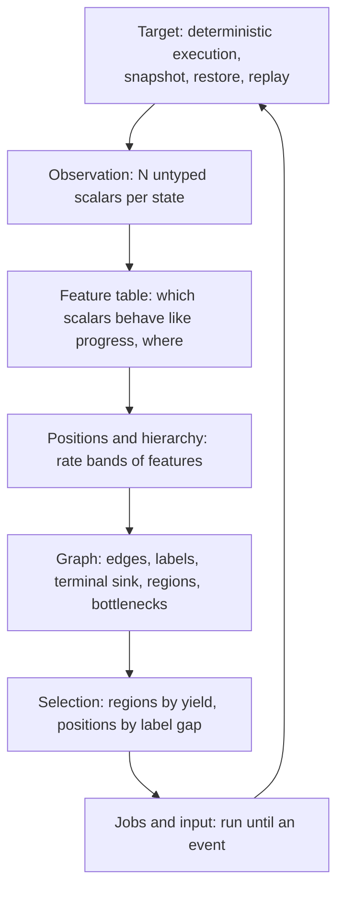
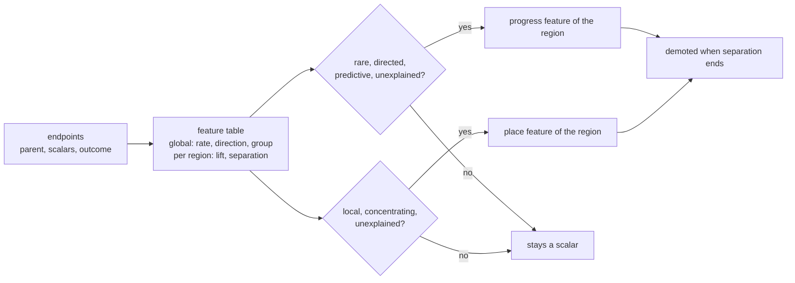
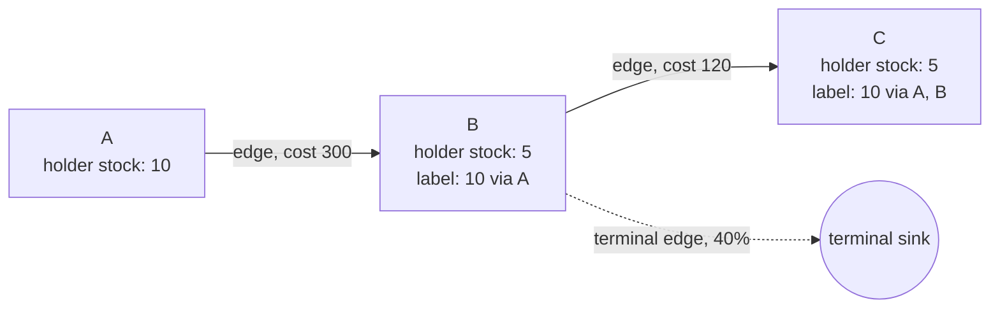
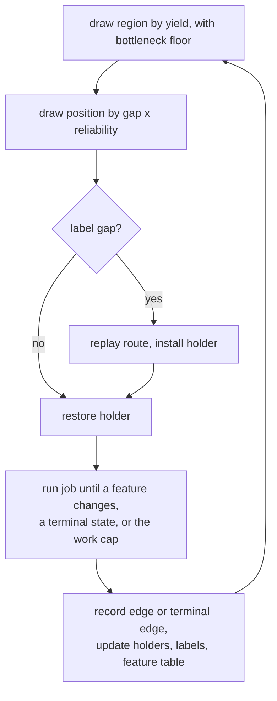

# Dissonance v3

Dissonance v3 is a state-exploration searcher. It drives a deterministic
target from power-on by restoring saved states, running short drawn
inputs, and keeping the endpoints that reach new places or bring better
stock to known places. It learns what counts as a place and what counts as
stock from the target's own observed state. It plans over the graph of
states it has visited. No per-target knowledge enters the searcher.

A target is anything the Harmony substrate can execute deterministically:
a game under an emulator, or a service under the VMM with fault injection.
The searcher sees every target the same way.

## Layers

Every layer takes only the layer below it. The observation layer is the
one place a target adapter exists, and it supplies format, never meaning.

## Observation

A state is observed as a vector of N scalars, each with an index and a
value and no name. The vector has two parts:

- the target's current state, such as memory bytes, registers, counters;
- the lineage's cumulative events, such as code paths hit, assertions
  fired, log templates seen, since power-on along this lineage.

The second part is state for the purpose of exploration: what a lineage
has caused is part of where it is. Cumulative scalars are directed by
construction.

An adapter emits a small set of scalars, one to about twenty, each a
memory field read at its natural width: a 16-bit position is one scalar, a
4-byte counter is one scalar. The adapter says which bytes form each scalar
and nothing else: no name, no order, no direction, no meaning. Everything
the searcher knows about a scalar it learns from the record.

## Feature table

A feature is a scalar, or a group of scalars that always change on the
same step, that the searcher has promoted. There are two kinds. A
**progress feature** behaves like a counter of advancement: it changes
rarely and in one direction. A **place feature** behaves like a coordinate:
it changes often, by small steps relative to its range, in either
direction, and states that differ in it have different futures. Horizontal
position is a place feature; items held is a progress feature. The searcher
keeps one table with a row per scalar or group.

Global columns, computed over the whole search:

- change rate, how seldom the value changes relative to work;
- direction, whether the value moves one way along lineages, or stays set
  once set;
- co-change group membership.

Per-region columns, computed inside each region:

- lift, how often a change precedes an event the graph treats as
  interesting in that region: a new region, a crossed bottleneck, an
  improved label, a burst of novel positions; terminal lineages count
  against;
- separation, whether the scalar still distinguishes lineages that
  continue from lineages that stop, conditional on the current position;
- promotion status and learned direction.

Every endpoint updates its row, kept or not, with time decay so the table
follows the search. Four tests promote a progress feature in a region:
rare, directed, predictive, unexplained. A clock is rare and directed but
fails the last two, since work explains it and terminal lineages carry it
too. Three tests promote a place feature in a region: local, meaning the
change per step is small against the range of values seen; concentrating,
meaning the states whose next job changed a progress feature occupy a
narrow band of its values against the spread over all states in the
region, so crossing a bottleneck requires being somewhere in particular;
and unexplained by work. A sprite animation counter is local but crossings
are spread over all its values, so it does not concentrate. A feature is demoted in a region when its
separation there ends.

The rate is global. The relevance is local. One scalar can form positions
in one region and be noise in another.

## Positions and hierarchy

Progress features are ordered by change rate. The slowest are global by
construction and define regions. Faster progress features promoted inside a
region, and the region's place features bucketed to a width learned from
their step size, define positions there.

- A **region** is the set of states sharing the values of the slow
  progress features.
- A **position** is the tuple of the region's promoted progress feature
  values and bucketed place feature values at a state.
- A **bottleneck** is a transition on which a slow feature changes.
- **Depth** is the number of bottlenecks from power-on.

When a region's promoted set changes, that region's positions are rebuilt
from its resident states. Other regions are untouched. The hierarchy is a
measured property of the data and moves as the table moves.

Before any feature is promoted there is one region, and every chosen
scalar is a place feature bucketed to the median change it shows over one
job, so one job can reach a neighboring position. A position is then the
tuple of every scalar's bucket, so any state whose vector lands in a new
tuple is kept. Promotion and demotion rebuild positions from this starting
point by the rule above; bucket widths follow the record and scalars leave
the position when the table rejects them. There is no separate bootstrap, no handoff and no model
learned ahead of the run.

## Graph

The search keeps the graph it walks.

- A **node** is a position with its holder, the state with the best stock
  observed there. Stock is the vector of slow directed features.
- An **edge** records that a job went from one position to another with a
  given input suffix and cost. Each edge keeps a landing rate,
  (landed + 1) / (attempted + 2).
- A **terminal edge** goes from a position to the terminal sink when a job
  from it ended at a state no job can continue from, with no gain. It
  lowers the reliability of every route through that position.
- A **label** on a position is the best stock any route of edges can bring
  there, with the route, its cost and its reliability. Labels are kept
  current by bounded relaxation over edges whenever a holder changes.

A label says more can be brought to a position than has arrived there.
Realizing a label replays its route from the holder at its start.

## Selection

Work is allocated at two levels.

Across regions, a region's share is its recent yield: novel positions and
label improvements per unit of work, discounted by terminal edges. A
bottleneck region that has not been crossed keeps a floor that does not
decay. Leaving it is worthwhile only when a label says a better-stocked
state can be brought in, or when another region is still yielding. Stock
found anywhere becomes a label at the bottleneck through relaxation, so
work elsewhere is credited there without a rule.

Within a region, a position's weight is its label gap, the distance between
its label and its holder's stock, times the route's reliability. Positions
without a gap share the remainder in proportion to recent novelty from
them, discounted by their terminal edges. A position that has not been
drawn yet is credited the region's mean novelty per draw, so untried
positions carry most of the remainder until they have been tried; this
is what moves the search outward before any label exists. A drawn position
with a gap is realized first, then explored from the arriving state.

## Jobs and input

A job restores a state and runs drawn input until its position changes,
the state becomes terminal, or the position's work allowance runs out. The
allowance is learned per position: a job that ends on the allowance with
no position change doubles it for the next job from that position, and a
position change resets it to the region's median job length. A state that
sits still for a long stretch, such as a cutscene or a slow service
operation, is therefore run through, never redrawn from the start of the
stretch. Job boundaries come from observed events, never from a fixed
amount of work.

Input is a set of independent control processes. Each control is on or
off, and the time to its next change is drawn from a hold distribution
whose rate is chosen per job from a small log-spaced set. Combinations
arise from overlapping holds. A second generator splices input suffixes
from recorded edges that moved a feature in the current region. An energy
mixture over generators and hold rates adapts their shares on novel
positions per unit of work. For a service, a control is a fault or a
workload action, and a hold is how long it stays applied.

## Retention

A position keeps one holder per stock ordering. An endpoint replaces the
holder when its stock is better, or ties with a lower cost from power-on.
Every endpoint, kept or not, contributes its edge, its scalars to the
feature table, and a terminal edge if it was terminal. A position whose
children keep ending terminal keeps its holder and is drawn rarely, never
at zero. Nothing about a state is decided at admission from one sample.

## Record and replay

The search writes a stream of every job: parent position, input suffix,
endpoint scalars, outcome, and the retention decision. Checkpoints hold
the graph and the resident states. Any kept state replays from power-on
under a second instance of the target and must match. Feature promotion,
label relaxation and region structure can all be recomputed offline from
the stream alone, so every analysis of a search is reproducible without
rerunning it.

## Mapping to targets

| concept | NES game | service under the VMM |
|---|---|---|
| observation scalars | chosen memory fields at natural width, unnamed | counters per process, cumulative coverage edges, fired assertions, log template ids |
| slow progress features | level, items held, area | scenario markers: leader elected, partition applied, snapshot taken |
| fast progress features | room, boss phase, boss health | coverage within a scenario, retry counts |
| place features | horizontal and vertical position, camera scroll | queue depths, in-flight request count, replication lag |
| stock | items, health, ammunition | cumulative coverage and assertion set carried by the lineage |
| terminal state | game over, soft lock | crash, process exit, harness timeout, unrecoverable cluster |
| bottleneck | boss fight, locked door, timed sequence | precondition most setups fail to reach, such as a fault landing inside an election |
| control | one controller button | one fault or one workload action |
| work | emulated steps | wall or virtual time under the VMM |
