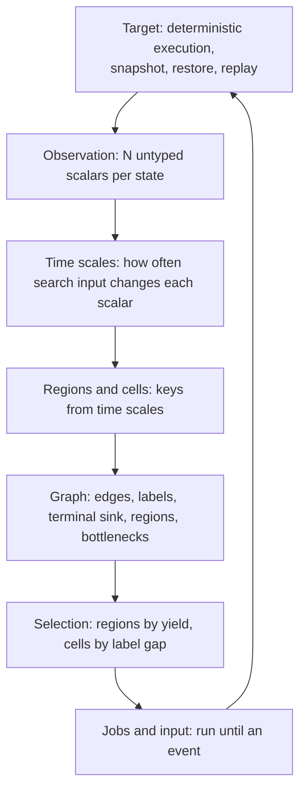
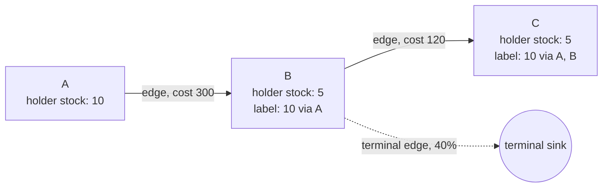
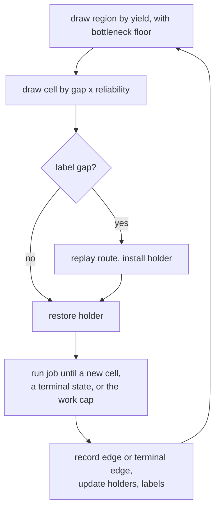

# Dissonance v3

Dissonance v3 is a state-exploration searcher. It drives a deterministic
target from power-on by restoring saved states, running short drawn
inputs, and keeping the endpoints that reach new cells or bring better
stock to known cells. It learns which scalars form regions and cells, and at
what width, from how often its own input changes them. It plans over the graph of
states it has visited. No per-target knowledge enters the searcher.

A target is anything the Harmony substrate can execute deterministically:
a game under an emulator, or a service under the VMM with fault injection.
The searcher sees every target the same way.

## Layers

Every layer takes only the layer below it. The observation layer is the
one place a target adapter exists, and it supplies format, never meaning.

## Observation

A state is observed as a vector of N scalars, each with an index and a
value and no name. The vector has two parts:

- the target's current state, such as memory bytes, registers, counters;
- the lineage's cumulative events, such as code paths hit, assertions
  fired, log templates seen, since power-on along this lineage.

The second part is state for the purpose of exploration: what a lineage
has caused is part of where it is. Cumulative scalars are directed by
construction.

An adapter emits a small set of scalars, one to about twenty, each a
memory field read at its natural width: a 16-bit position is one scalar, a
4-byte counter is one scalar. The adapter says which bytes form each scalar
and nothing else: no name, no order, no direction, no meaning. Everything
the searcher knows about a scalar it learns from the record.

## Time scales

The searcher orders scalars by how often its own input changes them. Slow
scalars whose cells hold most job edges define regions; every other kept
scalar defines cells inside a region.

### Search-caused novelty

A sampled holder gets one no-input job: the same start, no control on. The
first runs as long as the holder's current input allowance. It reruns from
the same start when a later input job runs past it without the no-input job
having ended, for the longest input job from that start or twice the frames
it already covers, whichever is longer. One no-input job per position runs
at a time; a job still running from before a rebuild or from a replaced
holder does not count. Like an input job, it stops at a new cell and runs at most 2^20
frames. Its length is how long waiting gets: a frame of an input job is
covered when the no-input job from the same start ran that long or ended. A
value an input job reaches at a covered frame is search-caused when the
no-input job from the same start never reaches that value at any frame.
Values compare at width 1. A value is new when the scalar changes to it
and the lineage has not held it in the same region, that is, with the same values of the current region key
scalars other than the scalar itself. A position scalar repeats its values
in every room, so without that context it would stop reaching new values
after the first rooms and sort among the slow scalars. Before a region key
exists the context is empty.

The time scale of a scalar is the covered frames along held lineages divided
by the number of search-caused new values on them, over 200 lineages spread
evenly over the kept states. A scalar with at least 10 new values of which
at most 0.1 are search-caused is dropped: waiting produces nearly every new
value it takes, as a frame counter or a timer does.

Among scalars with at least 10 new values, the search-caused share on SMB,
Metroid and Zelda is 0.001 or less for every frame counter and 0.25 or more
for every other scalar, so the drop rule
removes SMB's frame counter `$09` and one-second timer, Metroid's frame
counters `$2D` and `$2E`, and Zelda's counters `$15` and `$18`.

### Region key

Every scalar that is kept and has at least one search-caused value is sorted
by time scale, slowest first. Edges of the job graph join the distinct
scalar vectors at a job's start and end. For a set of scalars, the inside
share is the fraction of edges whose two ends hold the same values of every
scalar in the set. The region key is the longest slowest-first prefix whose
inside share is above 1/2. The prefix stops at the first scalar that would
bring the share to 1/2 or below. With an empty prefix there is one region.

On Metroid the order starts map x, energy, `$300`, with prefix shares 0.87,
0.83 and 0.40, so the region key is map x and energy. On Famidash level 17
it starts `$44D`, `$7A`, `$4A6`, with shares 0.67, 0.52 and 0.37, so the
region key is `$44D` and `$7A`.

### Widths

Region key scalars key at width 1. Every other kept scalar keys by the
square-root rule for histogram bins: width is the range the scalar's
observed values cover divided by the square root of its count of distinct
values, rounded up to a power of two, with a gap between consecutive values
counted at most one width toward the range. Dropped scalars leave the key.
Before the first estimate every scalar keys by the square-root rule.

The offline tool still groups scalars into levels by gaps between time
scales and reports them. No live decision uses the levels.

## Regions and cells

- A **region** is one value of every region key scalar.
- A **cell** is the tuple of the remaining keyed scalars at a state, each
  at its width, paired with the tuple the job left to reach it. A state
  reached by a transition no job has made is kept even when its tuple has
  been seen, so state the keys miss still shows up as new transitions.
- A **bottleneck** is a transition between regions.
- **Depth** is the number of bottlenecks from power-on.

### Updates

At each checkpoint, once the previous estimate has finished, a thread
reads the job stream and computes the dropped scalars and the region key,
from all sampled starts and from half of them.
From the first result that differs from the current one, the work of
later checkpoints is added up while results keep differing. When it
reaches the work that had run when the current one was set, the latest
result takes effect. A result that agrees resets the count. A change
rebuilds the cells from the resident states. A rebuild makes new
positions. Each sums the draws, new cells, work and children of the old
positions it merges and keeps their largest allowance. Its no-input state
starts over, with a new sampling decision. Square-root widths are
checked every 1,024 jobs, and a width change alone rebuilds the cells only
when the time since the last rebuild is at least nine times that rebuild's
duration. When consecutive rebuilds take similar time, width rebuilds
take at most a tenth of the main thread.

The share of holders that get a no-input job starts at 1/2. It halves when
the half-sample result equals the full result and doubles otherwise,
between 1/64 and 1. The report gives the current share and the no-input
jobs and work since the last report.

### Open problems

- Memory. A cell pairs a state's tuple with the tuple the job left, and
  that pairing multiplies the number of cells. On Metroid it gave 7.1 times
  as many cells as tuples, and 1.27 million residents at 2,470 s. Search
  memory must fit an ordinary computer.
- Scalars with one or two search-caused values. Their share and time
  scale rest on one or two events, so the drop rule and the order move them
  in and out of the region key between estimates. Each move resets the work
  a proposal has accumulated. SMB's timer hundreds digit flipped the
  proposal 9 times in one run, and Ice Climbers' airborne flag sorts first
  in some estimates and takes the inside share below 1/2.
- Time to the first region key. The first estimate needs about two
  checkpoints, so a search that finishes sooner runs with one region. 21
  of 22 Famidash levels ended before their first key.

### Open question: stock and labels

Stock was defined as the vector of slow directed features, and labels carry
stock between cells along edges. Time scales do not yet say which scalars are
stock. Stock, labels and label gaps below are kept as written until that is
decided.

## Graph

The search keeps the graph it walks.

- A **node** is a cell with its holder, the state with the best stock
  observed there.
- An **edge** records that a job went from one cell to another with a
  given input suffix and cost. Each edge keeps a landing rate,
  (landed + 1) / (attempted + 2).
- A **terminal edge** goes from a cell to the terminal sink when a job
  from it ended at a state no job can continue from, with no gain. It
  lowers the reliability of every route through that cell.
- A **label** on a cell is the best stock any route of edges can bring
  there, with the route, its cost and its reliability. Labels are kept
  current by bounded relaxation over edges whenever a holder changes.

A label says more can be brought to a cell than has arrived there.
Realizing a label replays its route from the holder at its start.

## Selection

Work is allocated at two levels.

Across regions, a region's share is its recent yield: novel cells and
label improvements per unit of work, discounted by terminal edges. A
bottleneck region that has not been crossed keeps a floor that does not
decay: the uncrossed regions together get at least the combined share of
the crossed ones. Only an uncrossed region is credited one novel cell
in advance; a crossed region's share falls with its yield to a small floor. A region is
crossed once any job leaves it, including a job that started in an earlier
region. Leaving it is worthwhile only when a label says a better-stocked
state can be brought in, or when another region is still yielding. Stock
found anywhere becomes a label at the bottleneck through relaxation, so
work elsewhere is credited there without a rule.

Within a region, a cell's weight is its label gap, the distance between
its label and its holder's stock, times the route's reliability. Cells
without a gap share the remainder in proportion to recent novelty from
them, discounted by their terminal edges. A cell that has not been
drawn yet is credited the region's mean novelty per draw, so untried
cells carry most of the remainder until they have been tried; this
is what moves the search outward before any label exists. A drawn cell
with a gap is realized first, then explored from the arriving state.

## Jobs and input

A job restores a state and runs drawn input until it reaches a cell
that was not known at dispatch, the state becomes terminal, or the starting
cell's work allowance runs out. The cell classifier and the set of
known cells are frozen together at dispatch and bound into the job's
replay evidence. Crossing between already known cells does not end the
job. A stale set may report a cell another worker has just discovered;
admission resolves that duplication without changing the recorded stopping
rule.

The allowance is learned per starting cell: exhaustion without reaching
a dispatch-new cell doubles it for the next job from that cell.
Reaching a dispatch-new cell resets it to the region's median job length.
An ordinary crossing into a known cell neither terminates the job nor
resets its allowance. Terminal states still end execution immediately. Job
boundaries come from observed discoveries, never from a fixed amount of work.

Input is a set of independent control processes. Each control is on or
off, and the time to its next change is drawn from a hold distribution
whose rate is chosen per job from a small log-spaced set. Combinations
arise from overlapping holds. A second generator splices input suffixes
from recorded edges that changed a region key scalar in the current
region. An energy mixture over generators and hold rates adapts their
shares on novel cells per unit of work. For a service, a control is a fault or a
workload action, and a hold is how long it stays applied.

## Retention

A cell keeps one holder per stock ordering. An endpoint replaces the
holder when its stock is better, or ties with a lower cost from power-on.
A job that enters a known cell below its holder's cost offers that
state the same way and continues. Every endpoint, kept or not, contributes
its edge, its scalars to the job stream the time scales are measured from, and
a terminal edge if it was terminal. A cell whose
children keep ending terminal keeps its holder and is drawn rarely, never
at zero. Nothing about a state is decided at admission from one sample.

## Record and replay

The search writes a stream of every job: parent cell, input suffix,
endpoint scalars, outcome, and the retention decision. Checkpoints hold
the graph and the resident states. Any kept state replays from power-on
under a second instance of the target and must match. Time scales, label
relaxation and region structure can all be recomputed offline from
the stream alone, so every analysis of a search is reproducible without
rerunning it.

## Mapping to targets

| concept | NES game | service under the VMM |
|---|---|---|
| observation scalars | chosen memory fields at natural width, unnamed | counters per process, cumulative coverage edges, fired assertions, log template ids |
| region key | level, items held, area | scenario markers: leader elected, partition applied, snapshot taken |
| slower cell scalars | room, boss phase, boss health | coverage within a scenario, retry counts |
| fastest cell scalars | horizontal and vertical position, camera scroll | queue depths, in-flight request count, replication lag |
| dropped scalars | frame counter, animation timer | heartbeat counters, clock readings |
| stock | items, health, ammunition | cumulative coverage and assertion set carried by the lineage |
| terminal state | game over, soft lock | crash, process exit, harness timeout, unrecoverable cluster |
| bottleneck | boss fight, locked door, timed sequence | precondition most setups fail to reach, such as a fault landing inside an election |
| control | one controller button | one fault or one workload action |
| work | emulated steps | wall or virtual time under the VMM |
