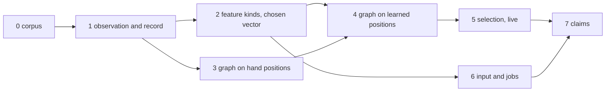

# Build Dissonance v3

## Outcome

Dissonance v3 sets the bar for state exploration. When this work is done,
no published system explores a deterministic target further, faster, or
with less target knowledge. It is a parallel searcher that saturates the
machine it runs on. The claims it ships with:

1. Super Mario Bros. from power-on to the ending with three untyped
   scalars as the observation (horizontal position, vertical position,
   level), on all of ms02, within 3x the tries and wall time of the
   current searcher's run with its hand-written key.
2. The Famidash base level set, every level beaten from its start with
   untyped scalars as the observation, within 3x the total tries of the
   current searcher with its hand-written key.
3. Metroid from power-on to the ending with a chosen vector of unnamed
   scalars as the observation, within 3x the tries of the current
   searcher's run with its hand-written key, with every milestone (bombs,
   Kraid, high jump, Ridley, Tourian, ending) reached and replayed. The
   searcher is told nothing about what any scalar means.
4. Castlevania as the held-out game: untouched during development, then
   given a chosen vector at the end and run from power-on with the same
   try budget as the stage 0 position-only run. It reaches every stage the
   stage 0 run reached, in at most 3x its tries per stage, and reaches at
   least one stage beyond. No run of any searcher has finished Castlevania,
   so the yardstick is the stage 0 run, stage by stage. It shows the
   searcher works on a game it was not built against.
5. A faults workload (NATS or rqlite) where promoted features name
   scenario markers nobody wrote down, and the search reaches a failure
   the current searcher does not reach in equal work.

Capability first, then speed. The current searcher cannot do claims 1, 2,
4 or 5 at all, because it needs a hand-written key. Finishing these games
and workloads with no key is the result. Once a claim holds, the ratio to
the current searcher is reported as information and becomes the target of
a second phase of measured improvements, one change at a time, on the
recordings the first phase produced. A working mechanism is never thrown
out because a ratio came in at 1.02x or 1.5x. It is kept, recorded, and
improved.

Live work runs in that order because feedback time differs by a thousand
fold: SMB from power-on takes three minutes and its failure modes are the
best understood in this repository, a Famidash level takes seconds, a
Metroid rooted segment tens of minutes, Metroid from power-on hours. Debug
the live loop where a mistake costs minutes and the failure is recognizable. Famidash and SMB are linear
and bounded, so they never exercise stock carrying, bottlenecks that need a
better-equipped state, hidden counters in a fight, or backtracking across
regions. Those are what Metroid is for, and they are scored offline on the
Metroid recording from day one in stages 2 to 4, in minutes, so no
mechanism built for Metroid waits on a Metroid run to be tested. The
Metroid rooted segment in stage 5 is the first live check of stock
carrying and precedes any power-on run.

Fast still means fast. Every run uses every core it can. A run that takes
hours where the current searcher takes minutes is a defect to diagnose,
and the diagnosis goes in the log beside the result, but it does not stop
the claim from being pursued.

The design is `DISSONANCE-V3-DESIGN.md`. Read it first, then this file.

## Why this is within reach

Every part of the design is either already running or already measured.

- The deterministic substrate exists: emulator cores, the VMM, snapshot and
  restore, replay under a second instance. It is used through its public
  interfaces and is not changing.
- Route labels were measured offline on recorded power-on runs of SMB and
  Metroid. For each milestone, the label at a position predicted the stock
  the search eventually realized there 6 to 12 times earlier than the
  search found it (lead ratios 0.08 to 0.17 on early milestones). The
  information is in the graph. The draw does not use it.
- Terminal outcomes matter and are measurable: on a stalled SMB archive,
  18.5 percent of top-tier draws went to parents whose children ended
  terminal over 90 percent of the time. Entries with later progress had 15
  percent terminal children; entries without had 36 percent.
- Jobs that stop when they leave their cell beat fixed-work jobs on a
  calibrated climb world at 0.42x tries.
- Throughput is at parity with the best public number: SMB power-on to
  ending cost 49 worker-minutes on ms02. The gains left are in the key and
  the allocation, which is all of v3.

## Method

Develop offline first. A recorded search is a stream of jobs with parent,
input, endpoint scalars and outcome, plus checkpoints with resident
snapshots. Every v3 component is a function of that record. Build each
component as a tool that reads a record, score it by hindsight against
what the recorded search did, and only then put it in the live loop.

Hindsight scoring is the same for every component: for each milestone the
recorded search reached, find the earliest point at which the component
would have pointed the search at it. Report the ratio of that time to the
recorded time. A component that does not shorten the ratio on the record
will not shorten the live run.

Rules that make this fast:

- Record once, analyze many times. Keep every checkpoint and the full
  stream. Delete nothing that a pass line cites.
- Preregister every scored run: question, pass line, budget, seeds, binary
  hash. Append it to the attempts log before the run and the result after.
  The attempts log is `dissonance-v3/ATTEMPTS.local.md`, a new file that
  starts empty with this work. It is the only record of runs; nothing else
  in the repository is consulted for history. A scored run is one whose
  result bears on a pass line. Builds, unit tests, lint, file copies,
  storage work and diagnostics are not preregistered and not logged; one
  entry per scored run, at most fifteen lines, result included.
- Infrastructure is not the work. Storage formats, memory layouts, disk
  guards and tool speed get attention only when a pass line cannot be
  computed at all. A hindsight pass that needs four hours and 30 GB on ms02
  is run that way, once, before any optimization. A recording that is not
  cited by a pass line is deleted when disk is short. A run that reaches its budget is recorded as reaching the budget,
  never as a failure.
- A test is uninformative when the control is at 0 of N or N of N, when
  arms tie, or when the mechanism did not fire. An uninformative test is a
  defect in the test. Fix it and rerun.
- Live comparisons use rooted segments: same root snapshot, same budget,
  three fresh seeds per arm, median tries to a replayed witness. Power-on
  runs come last and confirm.
- Positive and negative controls in every harness: a known-good key must
  pass, a shuffled key must fail, before any candidate is scored.
- Pass lines are coarse by design. Every measurement has a granularity, such
  as the report cadence in a hindsight pass, and a result within one
  granularity step of its threshold meets it. A result of 0.2008 against a
  threshold of 0.2 measured in steps of 250,000 tries is a pass. Record the
  number, mark the stage passed, move on. Never rerun, retune or refine a
  measurement to chase a threshold, and never block a stage on a miss
  smaller than the measurement can resolve.
- Never ask for approval. Decide, record, proceed. A turn ends only when
  every machine has work in flight that cannot yet be analyzed, and then
  the turn schedules its own check.

## Hindsight method

A recording is a complete answer key for the search that produced it.
Every job is in the stream with its parent, input, endpoint and decision,
and every checkpoint holds the archive and the resident snapshots at that
try count. Each v3 component is scored by asking: given only the record up
to try t, would this component have pointed at what the search found
later, and how early? The procedure differs by component.

**Records to use first.** Both exist on ms02 under `/root/labels/runs`,
with milestone files giving the try count and input tape at each milestone.

- Metroid power-on, 24 workers, to Kraid defeated at try 24,043,400,
  22 checkpoints, 16 GB stream. Milestones: morph ball, missiles, bombs,
  long beam, energy tanks, Kraid area, Kraid door, Kraid defeated.
- SMB power-on to the ending, 1,244,927 tries, 118 checkpoints.

**Labels.** Replay the stream in order, maintaining positions, holders and
edges. At each report point (every 250,000 tries), run relaxation and
record every position's label. The ratio is quantized by the cadence, so
a ratio within one report step of a threshold meets it; a finer cadence may
be used when it is cheap, never to rescue a near miss. For each milestone,
take the position where it was realized and the stock the search realized
there. t_search is the
try at which the search realized it. t_label is the first report point at
which the label at that position already predicted that stock. Lead ratio
is t_label / t_search. Pass is a ratio at or below 0.2 on at least one
early milestone. Calibration values measured on these recordings: energy tank 0.13,
missile capacity 0.17, long beam 0.48, Kraid 0.8 to 0.95, SMB best 0.08.

**Feature kinds.** Build the chosen vector for every sampled resident at
each checkpoint by reading its snapshot. Compute the progress and place
tests per scalar per region, using the recording's own hand key only to
define regions for this test. The known answers are the hand key fields:
each should come out as the right kind with the right direction, and each
distractor should be rejected. The negative control is a copy of the vector
with scalar indices shuffled per state; it must promote nothing stable.
Report every scalar's test values and kind per region.

**Regions and bottlenecks.** Cluster the transition graph at each
checkpoint. Compare the partition to the hand key's room and area fields
with a standard agreement measure against a random partition of the same
sizes. For bottlenecks, at each checkpoint rank regions by depth and by
recent yield (novel positions and holder improvements in the last report
interval per unit of work) and report both ranks of the region holding the
next milestone the search reached.

**Terminal edges.** Mark every job whose endpoint was terminal. Rerun the
labels pass with reliability discounted by terminal edges. Pass is that the
lead ratio for the stalled step moves earlier than without them. On SMB the
step is 5-4 to 6-1.

**Selection cannot be scored by lead ratio.** A draw rule changes what
gets recorded, so hindsight cannot say what it would have found. Score it
offline by the draw share it would have placed on lineages that later
produced each milestone: replay the record, compute the rule's draw
weights at each report point, and report the share on ancestors of the
milestone against the share the recorded search actually spent on them.
Then go live with rooted segments.

**Why this is fast.** A full labels pass over the Metroid recording takes
under thirty minutes and 1 GB on one core of ms02. A feature pass over all
resident states at one checkpoint is seconds. Every component can be
scored on Metroid several times a day without running Metroid.

## Clean room

All work goes in `dissonance-v3/`, a new crate tree. The current searcher
under `dissonance/` is used only as a black box: run its binary to produce
recordings for stage 0, and parse its stream and checkpoint files from
their documented formats. Do not read its source. Its design decisions are
the thing v3 replaces, and reading them costs context and independence.
The execution substrate (emulator cores, VMM, snapshot and restore, replay)
is used through its public interfaces. As soon as v3's own loop runs, v3
records its own corpus and the black-box recordings are retired.

## Resources

| machine | use it for | notes |
|---|---|---|
| ms02 (24 cores: 8 P, 16 E, fastest) | recordings, live rooted segments, power-on runs | unrestricted; delete any file or process to free disk and memory; keep it saturated |
| this Mac (6 cores, 24 GB) | builds, offline hindsight tools, tiny worlds, unit tests | hard limit 6 cores and 24 GB across everything |
| msr1 (12 arm64 cores, slow) | held-out and secondary game recordings, replay verification, long benchmarks | unrestricted; same deletion rights |

Saturate all three at all times. Recordings are embarrassingly parallel
across games and seeds. Hindsight analyses are parallel across recordings
and components. Rooted segments are parallel across seeds and arms within a
machine's memory. When one machine is idle, it is running the next
recording or the next seed. When the Mac is the bottleneck, run the offline
tools on ms02 too.

## Stages

Each stage has an offline pass line. A stage is done when its pass line is
met and its result is in the attempts log. Stages overlap wherever their
inputs allow; the dependency graph is below.

### Stage 0: corpus (ms02, msr1, day one)

Record power-on runs with full stream and every checkpoint, using the
current searcher as a black box: SMB to the ending, every Famidash base
level, Metroid to the ending or as far as it goes, Mega Man 2, Punch-Out,
Castlevania with a position-only key, and one faults workload run
with coverage, assertion and log-template output. Three seeds each where
the game allows.

Pass: every recording replays from power-on under a second emulator
instance and matches its final checkpoint.

### Stage 1: observation and record (Mac)

The v3 adapter emits N untyped scalars per state. NES: every RAM byte,
with 16-bit pairs merged by carry correlation measured from the record.
Systems: coverage edges, assertions, log templates, counters, plus the
lineage's cumulative event set. The v3 record format carries a scalar
sketch per endpoint and a terminal flag per job. A converter turns stage 0
recordings into v3 records by replaying their resident states and reading
scalars.

Pass: the hand key of every recorded game is a function of the emitted
scalars, shown by recomputing it from the v3 record.

### Stage 2: feature kinds on a chosen vector (Mac, offline, minutes)

Each game's adapter emits a chosen vector: the fields of its hand key read
at natural width as unnamed scalars, plus two or three distractors such as
a frame counter, an animation byte and a sound byte. Implement the feature
table with both feature kinds over that vector: the four progress tests
and the three place tests. Promote per region. Learn direction. The
concentrating test needs only parents and whether their job changed a
progress feature: compare the spread of a scalar among parents of
progress-changing jobs against its spread among all parents in the region.

Pass, with negative control: on SMB, Metroid and Famidash, every progress
field is promoted as a progress feature with the correct direction, every
position field as a place feature, every distractor is rejected, and a
shuffled-scalar control promotes nothing stable. Run on a uniform sample of
20,000 residents per checkpoint. Stages 4 and 5 build on this result.
Castlevania gets no chosen vector until stage 7.

### Stage 3: graph on hand positions (Mac and ms02, from day one)

Build the graph layer in v3 from scratch: edges, terminal edges,
reliability, labels with bounded relaxation, rate-band regions and
bottlenecks. Run it offline on positions taken from the recordings' hand
keys so it can be scored before stage 2 lands.

Pass: label lead ratios at or below 0.2 on at least one early milestone of
SMB and of Metroid; regions agree with room and area fields better than a
random partition of equal size; the region holding the next milestone's
lineage ranks in the top three by recent yield at the checkpoint before
each arrival, and yield ranks it at or above depth on a majority of
checkpoints, with both ranks reported at every checkpoint. Checkpoints
where it misses both ranks are a stall, and the stall's length and the
regions that outranked it are recorded as input to stage 5. Depth alone picks the frontier on a linear game
and fails where the map branches, which is the case the two-level
allocation in stage 5 exists for, so a depth miss with a yield hit is a
pass and a design input. The stage passes on retained-only records,
which is all the black-box recordings contain. The terminal-edge check,
that terminal edges move the SMB 5-4 prediction earlier, waits for the
first v3-recorded corpus and does not hold the stage.

### Stage 4: graph on learned positions (Mac, offline)

Run stage 3's tools on positions built from stage 2's features.

Pass: lead ratios within 1.2x of the hand-position ratios on SMB and
Metroid, and the hierarchy by change rate reproduces area above room above
position.

### Stage 5: selection, live (ms02)

Build the v3 live loop: parallel workers, region-by-yield allocation with
the bottleneck floor, the label-gap draw with realization, the terminal
discount. Rooted segments against the current searcher, in this order: SMB 5-4
to 6-1, a Famidash level that stalls the current searcher, Metroid
post-Kraid to high jump; three seeds per arm.

Pass: v3 arrives on at least 2 of 3 seeds on every segment within 3x the
control's median tries, every witness replayed. Report the median ratio,
the hop landing rate and wall time per try at equal worker count as
information. A ratio above 1 is a note for the improvement phase, never a
reason to remove the mechanism.

### Stage 6: input and jobs (Mac, then ms02)

Feature-terminated jobs. Independent control processes with log-spaced
hold rates. Splice from edges that moved a feature in the region. Energy
mixture over both.

Pass: a tiny-worlds panel built for v3 with positive and negative controls
and no failed rule, and a Metroid rooted segment that arrives on at least
2 of 3 seeds with selection held at stage 5's build. Report the ratio to
the fixed-work control on the calibrated climb world and the segment as
information.

### Stage 7: the claims (ms02, msr1)

Run the five outcome claims. Every claim ships with its recording, its
replayed witness, and its attempts-log entry.

### Stage 8: improvement (all machines, after every claim holds)

With the claims recorded, work inward. Each change is one mechanism, scored
first offline on the stage 7 recordings and then on rooted segments, with
the stage 7 numbers as the control. Candidates in order of expected gain:
relaxation budget and label staleness, the bottleneck floor, hold rate set,
splice share, feature demotion speed, parallel admission order. Ship each
gain that holds; log each that does not with its cause.

## Parallel schedule

Day one: stage 0 recordings on ms02 and msr1 for every game at once; stage
1 adapter and stage 3 graph code on the Mac. Day two onward: stage 2 on the
Mac against records as they land, stage 3 hindsight on ms02 between
recordings, stage 6 input work on the Mac in parallel with stage 2 because
it depends only on the record format. Stage 5 starts on ms02 the hour
stage 4 passes.

## Deliverable

One pull request on a branch from main, one semantic commit per stage,
each commit passing the repository checks for the crates it touches. Rust
carries no comments beyond the SPDX header, and no `unsafe` blocks.
Component knowledge goes in `dissonance-v3/README.md` and the READMEs
beside each crate. Run the `shipping-code` skill when the
branch is complete.

## Do not

- Read any existing searcher code under `dissonance/`. Use its binary and
  its documented file formats only.
- Write a per-game key, progress rule, or probe into the searcher. The
  adapter supplies scalars and nothing else.
- Decide a state's fate at admission from one sample. A terminal outcome
  is a learned edge weight, never a filter.
- Treat a budget hit as a failure, a tie as a verdict, or a 0 of N control
  as evidence.
- Keep a fixed-work job rule. Jobs end on observed events.
- Throw out a working mechanism over a ratio. Capability is the result;
  speed is the next phase. Log the ratio and move on.
- Chase a threshold. A miss smaller than the measurement granularity is a
  pass. A larger miss is a result to record and diagnose in one paragraph,
  then the plan continues.
- Accept slow silently. A v3 run far slower per try than the current
  searcher at equal workers gets a diagnosis in the log, alongside the
  claim it is pursuing.
- Write `unsafe`. The substrate's interfaces are safe; if one is not, the
  fix goes in the substrate.
- Stop. A closed line needs the cause named and shown in the log. Six
  design variants or 48 hours per line before it closes, and the plan
  continues on every other line meanwhile.

Begin by stating which recordings start on which machine in the first
hour, and the first offline pass line you will score. Then execute.
