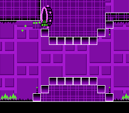

<!-- SPDX-License-Identifier: AGPL-3.0-or-later -->

# Dissonance Famidash investigation

Actual arcade Dissonance searches reproduced three additional openings in
the early built-in levels. These are level-data defects in the official
Famidash 1.2.8 ROM, independently reproduced in FCEUmm. This package also
retains a Dissonance reproduction of the previously confirmed Fofii escape.

| Level / opening | Recorded behavior | Tested repair |
| --- | --- | --- |
| Stereo Madness / final ship ceiling | Enters ceiling fill at frame 4,619, (12,721, 750); still alive at frame 5,100, (14,052, 721) | Closes the stepped ceiling; input dies at frame 4,614 in both cores |
| Base After Base / hollow ground block | Enters `CHECKERBOARD_15` through the left side; recorded endpoint (3,108, 881) at frame 1,143 | Adds the missing wall tile; input dies at frame 1,103 in both cores |
| Base After Base / ship ceiling | Enters ceiling fill near (9,018, 766); recorded endpoint (9,107, 769) at frame 3,312 | Adds two missing wall tiles; isolated ceiling repair kills the input at frame 3,278 in both cores |
| B-Sides Fofii / pit control | The actual search recovers the known below-course endpoint (4,268, 897) at frame 1,463 | Existing pit repair kills the recovered input at frame 1,317 |

Frames count from the normal arcade level start. The Base After Base inputs
were trimmed from the multi-level Dissonance campaign at a matching normal
level-start state. Every subsequent mechanical frame still matches the full
campaign trace in QuickNES. These are ordinary A/release histories; snapshots
are not required for playback.

Stereo Madness entering the ceiling fill, rendered by QuickNES:



## Search provenance and limits

`searches.json` separates executions, observed points, inspected snapshots,
unavailable snapshots and candidates. The two discovery campaigns used
seed 6 from level 0 for 80,000 executions and seed 7 from level 6 for 50,000.
Together they reached the first eight built-in levels, plus part of Cycles.
Their 124 candidates are detector signals, not 124 confirmed bugs. Other
candidates, including one in Cycles, still need review. This is not an
exhaustive catalog or evidence that other levels are bug-free.
Those discovery runs preceded the added reference-route screening. Their
candidate counts reflect that earlier detector; the current runner can
report different candidate counts with the same Dissonance search paths.

The Fofii positive control starts after 1,200 frames of the existing clearing
route, then Dissonance generates the new continuation. It succeeds with seed
1 in the retained 4,096-execution run. A start-of-level search did not recover
the escape within its earlier 50,000-execution budget; checkpoint placement
matters for a difficult level.

The shipped arcade Rust/WASM search engine was used unchanged:

* Search WASM SHA-256: `25d8e3053fd568d617b128dcb4b8f25e195852e315a64b09238197175e597f1c`
* QuickNES WASM SHA-256: `d63a56ff06a9b08a01155fe04df37d4f6577c110712882c59d232f4cf2acbf31`
* Main release ROM SHA-256: `7acf068a406d551ff18afa3fc1ed228ff90f72651c4a90a3862b997240bb9b58`

The harness calls `CampaignSearch.plan`, `CampaignWorker.run` and
`CampaignSearch.admit`. Its scripts inspect retained states, test released
continuations and replay controller histories. They do not replace
Dissonance's archive, selection or input generation. Geometry overlap and
distance from a reference path are triage signals, not exact NES collision
oracles. The runner reads each retained snapshot's actual RAM coordinates;
it does not infer coordinates from the visualizer's pixels.

The original custom-mutation audit missed `CHECKERBOARD_15`, the fill used
here, and used clearing routes as reference bounds. The original Base After
Base clearing route itself enters the ground-block opening. Completion
therefore cannot certify a legal route. The Dissonance runner disables
reference bounds for controls with interior-fill signals and still runs
direct geometry checks. Further tile styles, dual states and other collision
classes need additional detectors and review.

## Repairs and controls

All coordinates are zero-based source cells; these 27-row release levels
start at world y 480. The release patch changes six cells:

| Level | Column | Row | Old metatile | New metatile |
| --- | --- | --- | --- | --- |
| Stereo Madness | 795 | 16 | 39, lower-left corner | 34, left wall |
| Stereo Madness | 795 | 17 | 47, non-colliding fill | 34, left wall |
| Stereo Madness | 795 | 18 | 0, empty | 39, lower-left corner |
| Base After Base | 188 | 24 | 47, non-colliding fill | 34, left wall |
| Base After Base | 564 | 17 | 47, non-colliding fill | 34, left wall |
| Base After Base | 564 | 18 | 47, non-colliding fill | 34, left wall |

`early-release.patch.gz` contains source and generated data for release commit
`0df680d0e02f0ccb438f1224d162a0ab073b7204`. Stereo Madness grows from 1,846 to
1,847 compressed bytes; Base After Base grows from 2,017 to 2,019. Existing
bank placement is preserved: bank 09 grows from 8,186 to 8,188 bytes, and bank
20 from 7,407 to 7,408. Both fit the 8,192-byte limit. `stereo-release.patch.gz`
retains the separately tested Stereo-only change. Decompress these generated
release patches before `git apply`; the current-upstream source proposal is
plain text.

The tested combined release ROM SHA-256 is
`c835ef71af6b5e282a0c2c2304636510f78712569973f0a201d7bfcea0396fe6`.
To isolate the Base After Base ceiling repair, its ground-wall edit was
omitted while keeping the Stereo repair. That ROM's SHA-256 is
`f2922a5b2e27cf0f4eb534909ec77d618e43a81367abeaeaa5a26adec500dd95`.
The ceiling witness also takes the earlier ground opening, so the combined
repair correctly kills it there; the isolated test establishes that the
ceiling repair independently works.

The local compiler differs from the release compiler. Verification used the
official ROM plus the data/pointer delta between original and repaired
source builds with the same compiler. Every original byte at each changed
offset matched the official release before application (zero conflicts).
An arbitrary rebuild need not have these hashes or identical entry timing.

The existing Stereo control remains mechanically identical for all 5,124
frames. Dissonance found a replacement Base After Base control on the repaired
ROM in 17,504 executions, seed 1. It completes in 4,973 frames, never enters
the checked interior fill, and has identical gameplay on the original,
combined-repair and ceiling-only ROMs. It is embedded in both Base witnesses.
`early-controls.json` records unchanged controls for all first eight levels,
using that replacement for Base After Base. The production route table and
the arcade's official ROM are not changed by this investigation.

FCEUmm matches every recorded gameplay frame after entry animation. The
early main-level witnesses differ only in x on entry frames 1 and 8; the
explicit `--intro-frames 40` checks frames 41 onward and reports those two
differences. Fofii matches the complete trace. Both repaired approach traces
and the included clearing controls are checked. `*-independent.json` files
record hashes and results. FCEUmm revision:
`ac0d00a7fc01166f84c7bac01d1084ebfd2b865e`.

## Run and replay

From the repository root, use the arcade's built WASM bindings and QuickNES
runtime (see the demo README for `tools/build-runtime.sh` prerequisites):

```sh
node demos/twin-dragons/tools/famidash-audit/dissonance.mjs \
  source.json famidash.nes RUNTIME_DIRECTORY \
  demos/twin-dragons/rust/pkg/twin_dragons_browser.js \
  demos/twin-dragons/rust/pkg/twin_dragons_browser_bg.wasm \
  OUTPUT_DIRECTORY --seed 6 --executions 80000 --tail 32
```

The runner is specific to the pinned release RAM map. Its report hashes the
ROM, source index, core, search WASM, bindings and runner. `--side`, `--level`
and `--checkpoint` select a normal-play root. `--clear 1` saves a replayable
clearing route and stops when the starting level is completed; it was used
to obtain the repaired Base control. Natural spawn protection is allowed
during replay; candidate endpoints exclude invincibility, debug and pause.

The retained runs used the production assets fetched on 2026-10-18 at
`https://ph14.github.io/harmony/arcade/assets/`:
`campaign-BLO6QPAW.js` and `twin_dragons_browser_bg-Bb_brAX9.wasm`.
The original JS SHA-256 is
`bed6901a5145719e7b5f973a1ea77c4753753ae9d24415a1cfc4a7d20b2e7fd4`.
For Node inspection only, a local `.mjs` copy appended this export line:
`export { B as CampaignSearch, H as CampaignWorker, Y as default };`.
The adapted JS SHA-256 is
`253c6e8b114eebaf22d9c125cd9653a1ac89277415685fac372d9436ac293b4d`.
Those aliases are specific to that checked bundle, not a general API for
other minified builds. No generated binaries or ROMs are vendored here.

```sh
node demos/twin-dragons/tools/famidash-audit/dissonance-replay.mjs \
  CASE.json.gz ROM RUNTIME_DIRECTORY
python3 demos/twin-dragons/tools/famidash-audit/fceumm.py \
  CASE.json.gz FCEUMM_CORE ROM --intro-frames 40
```

Append `--fixed` when checking a repaired ROM. Omit the intro exclusion for
the Fofii witness. Campaign replay accepts menu transitions in multi-level
histories; it validates the full mechanical trace. It does not require the
search WASM or a stored emulator snapshot.

## Current-upstream proposal

`../../examples/early-current.patch` and its guarded edit specification target
upstream commit `541d68ffcae2096f116146ef21cbc4d62886eb6b`. The same openings
remain in the shared `lvlset_HUGE` sources. Current Stereo uses GID 0 for its
empty cell, whereas the release uses GID 1; the specifications check the
actual old values and file hashes rather than blindly copying release edits.
The proposal passes `git apply --check` but has not been built, replayed or
submitted against the current upstream ROM.

After application, regenerate A and HUGE, build both, verify bank capacity,
check the current RAM symbols and replay the witnesses and controls:

```sh
python3 LEVELS/export_wrapper.py -l A
python3 LEVELS/export_wrapper.py -l HUGE
make -B main huge
```

These findings justify local boundary repairs, not globally making decorative
tiles solid. The reusable upstream workflow is Dissonance discovery, ordinary
input replay, independent-core confirmation, source/collision review, a
guarded source patch, and a legal clearing control on the repaired build.
The separate Select Payment Type finding still needs collision-engine work;
this investigation does not establish a universal engine fix.

`collision-tiles.json` also checks the three source interior tiles against
the live collision maps in cartridge RAM. All three are metatile 47 with
`COL_NONE`; the source attribution agrees with the game being replayed.
Famidash-derived source and level data retain the MIT license in
`../../LICENSE-FAMIDASH.txt`.
